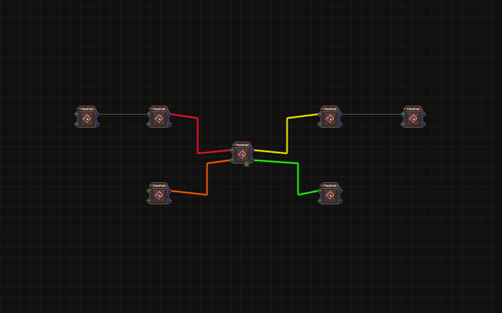

# Path Finder 1.0.2

[Download the latest release](https://github.com/urakkaamyx/KingdomInc_PathFinder/releases/latest) · [Source and issues](https://github.com/urakkaamyx/KingdomInc_PathFinder)

Hover a Kingdom Inc node to highlight every pipe to its **immediate parents and immediate children**. Each line uses **one solid bright neon color**, chosen from a rainbow palette, with a wider glow. Highlights follow the existing pipe bends and mirrored ports. Indirect ancestors and descendants stay unhighlighted.

When highlighted pipes share a straight section, their colors separate into narrow parallel lanes and fan back into the original path at either end. This keeps overlapping colors visible without changing the native pipes, their colliders, or saved bend positions. Ordinary crossings and separate lines retain their existing shape.

A **tiny pin button at each node's top-left corner** locks its direct paths on screen after you move the mouse away. The button has a beveled bronze frame, a burgundy enamel face and a tilted gold thumbtack. Hover brightens the metal; clicking adds a cyan rim and glint. Click again to unpin. You can pin multiple nodes and hover another node at the same time; shared pipes are drawn once and keep their color while visible. Pins last for the current loaded kingdom session and are not written into saves. Hidden kingdoms do not show their pinned paths; switching back restores them. Deleting a node removes its pin.

## Install, update, and remove

Requires Kingdom Inc's Unity Mono build and BepInEx 5. Tested against **Release v1.0.10**, Unity **6000.3.27f2**, and BepInEx **5.4.23.6**. No other mod is required.

Close the game and extract the player ZIP into the game directory. The resulting file must be `BepInEx/plugins/PathFinder/PathFinder.dll`. Start the game and hover a connected node or click its pin. For an update, close the game and replace that DLL. For removal, close the game and delete the PathFinder plugin folder. Existing saves can be used after removal; this mod adds no model types or saved data.

Manual installation is supported. Vortex deployment has not been tested.

The local installer accepts `-StageForNextLaunch` while the game is running. For updates, it preserves the running game's mapped DLL in the project's backup folder and places a fresh DLL for the next launch. Restart to see the new version.

On first normal launch, settings appear in `BepInEx/config/urakka.kingdominc.pathfinder.cfg`:

| Setting | Default | Meaning |
| --- | --- | --- |
| Highlights / Enabled | true | Enable hover and pinned path highlights |
| Highlights / Width | 5 | Solid core width in world units (2–12); glow scales with it |

Eight neon colors are reused when more than eight lines are highlighted. Colors are assigned as lines become visible and are not saved. Popups block hover highlighting behind them. Dragging suppresses hover selection; pinned paths remain visible. The original pipe renderer retains its normal transfer/rejection colors underneath the temporary highlight.

## Screenshots

The center node highlights its two immediate parents and two immediate children; the farther pipes remain unchanged.



Enlarged render of the actual pin graphics: idle, hover and pinned. The in-game buttons remain 18 world units square.


## Build and verify

Keep this source at `<game>/_Mods/PathFinder` with local game and BepInEx assemblies available. Requires a .NET SDK supporting .NET Standard 2.1 and Python 3 for packaging.

```powershell
dotnet build _Mods/PathFinder/PathFinder.csproj -c Release
& ./_Mods/PathFinder/verify-isolated.ps1
& ./_Mods/PathFinder/verify-isolated.ps1 -WithExistingPlugins
& ./_Mods/PathFinder/install.ps1
python _Mods/PathFinder/Tools/package_nexus.py
```

The diagnostic launches a private runtime with a disposable kingdom. Save writes, latest-save loading, and Steam achievements are blocked. It exercises actual UI raycasts and mouse input, both direct parents and children, solid colors, bent/straight/mirrored pipes, rewiring, loops, pin/unpin clicks, combined pins and hover, visibility changes, cleanup, and deletion of a pinned node. Reports and gameplay screenshots are under `Verification/`.

The optional companion run loads installed PartyNode, SharableBlueprints, KingdomFactoryApi, and LedgerMod DLLs, with the API on a private port. It checks Path Finder's native-node fixture with those mods loaded; it does not retest every companion feature or custom-node layout.

Packaging requires matching built, installed, and tested DLLs and passing isolated/companion reports. It checks archive paths, clean extraction, and SHA-256. Game binaries, BepInEx binaries, saves, and configuration files are excluded.

## Credits

Author: Urakka. Pin art is drawn procedurally; no game assets are redistributed. The isolated diagnostic workflow follows the existing PartyNode/LedgerMod projects in this workspace. Source licensing is not yet selected.

Plugin ID: `urakka.kingdominc.pathfinder`. Assembly: `PathFinder.dll`. Repository: [urakkaamyx/KingdomInc_PathFinder](https://github.com/urakkaamyx/KingdomInc_PathFinder).

For troubleshooting, check `BepInEx/LogOutput.log` and include the game, loader, and mod versions plus the connected node types.
